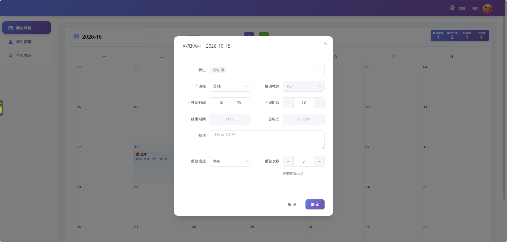

# Course-Arrange

培训机构用的排课系统。管理员维护课程和学生，教师查看自己的课表并给学生排课，学生用账号登录后查看自己的课程。

登录账号和展示昵称是分开的，昵称可以重名。同一时间段可以给多名学生排同一节课，日历上只显示一条；这些学生的单课时长必须相同。课时不够时会提醒，确认后仍然可以排课。

**禁止商用。** 本项目只允许学习、教学和个人非商业使用。详见 [LICENSE](LICENSE)。

## 界面

首页按身份进入：


管理员和教师从同一个入口登录，学生单独登录：


登录后在「我的课表」按月查看和排课：



## 启动

需要已安装并启动 [Docker Desktop](https://www.docker.com/products/docker-desktop/)。在项目根目录执行：

```bash
docker compose up -d --build
```

浏览器打开 http://localhost:8080 。

```bash
docker compose logs -f    # 查看日志
docker compose down       # 停止
```

也可以双击根目录的 `deploy.bat`。

首次启动会用 `doc/数据库备份/db_course_arrangement.sql` 初始化空库。上传的图片保存在 Docker 卷 `uploads_data`。数据库密码默认 `123456`，可用环境变量 `MYSQL_ROOT_PASSWORD` 修改；站点端口默认 `8080`，可用 `WEB_PORT` 修改。

改过初始化脚本后，需要重建数据卷才会重新导入：

```bash
docker compose down -v
docker compose up -d --build
```

## 本地开发

后端需要 JDK 8 和 Maven：

```bash
mvn spring-boot:run
```

前端需要 Node.js 16（Webpack 3 不适合更新的 Node）：

```bash
cd UI/coursearrange
npm install --registry=https://registry.npmmirror.com
npm run dev
```

后端默认端口 `8008`。Windows 上结束占用该端口的进程：

```bat
for /f "tokens=5" %a in ('netstat -ano ^| findstr :8008') do taskkill /f /pid %a
```
